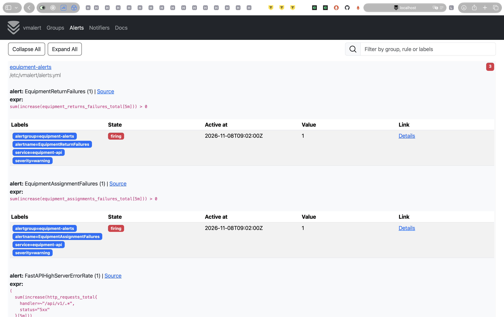
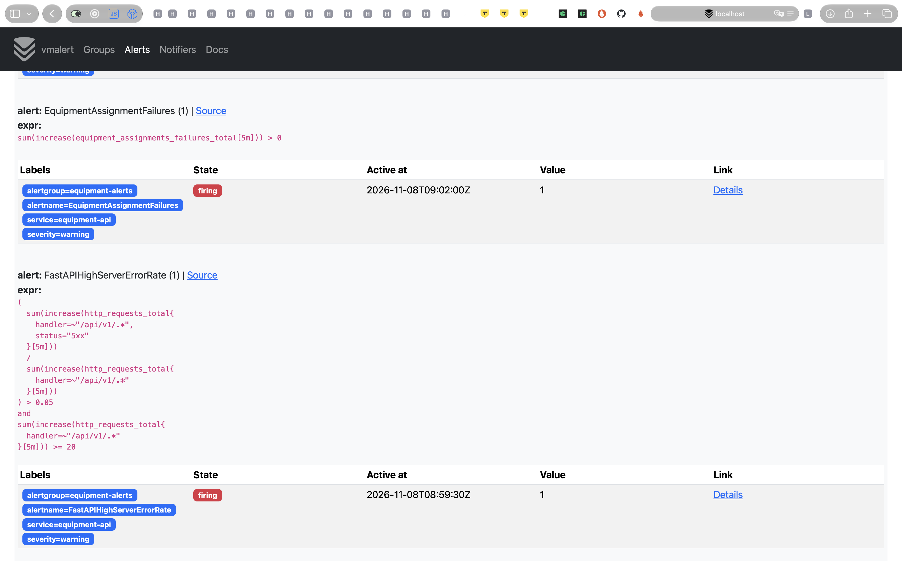
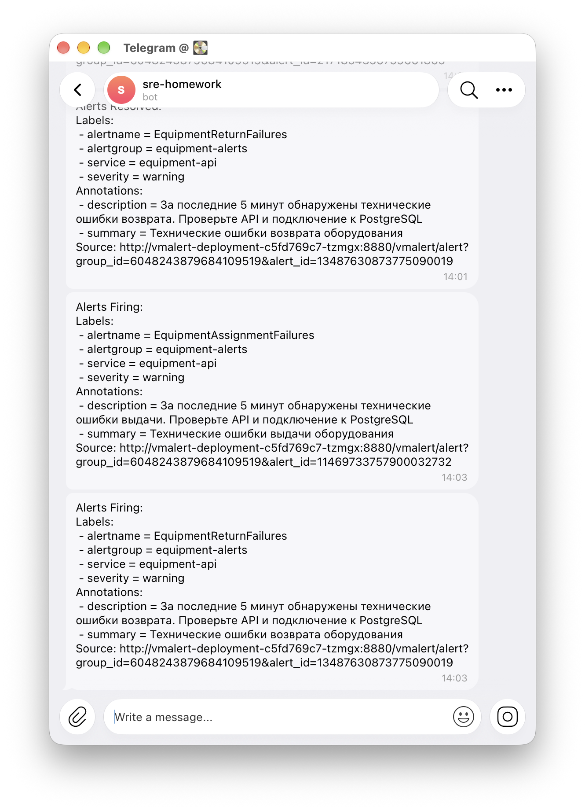
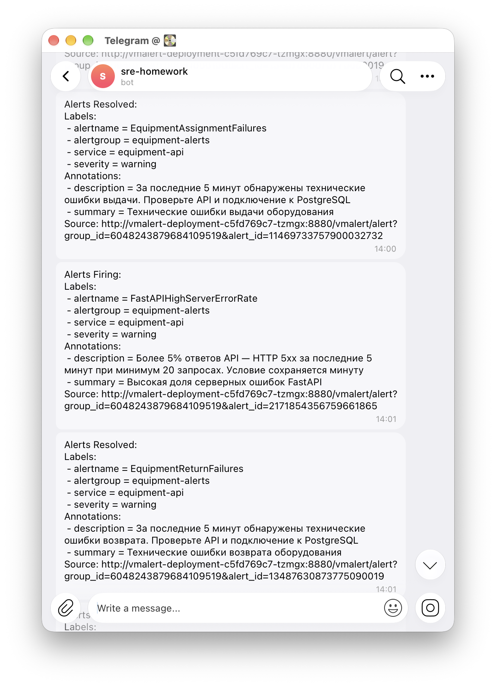

# Алерты сервиса учёта оборудования

VictoriaMetrics собирает метрики приложения, vmalert проверяет правила, Alertmanager отправляет уведомления в Telegram.

| Алерт                         | Метрика и условие за 5 минут                                                                    | Почему выбрал                                                                                                                                                   |
| ----------------------------- | ----------------------------------------------------------------------------------------------- | --------------------------------------------------------------------------------------------------------------------------------------------------------------- |
| `EquipmentAssignmentFailures` | Прирост `equipment_assignments_failures_total` больше нуля                                      | Техническая ошибка мешает выдать оборудование. Для небольшого сервиса достаточно одной ошибки, чтобы проверить причину.                                         |
| `EquipmentReturnFailures`     | Прирост `equipment_returns_failures_total` больше нуля                                          | Ошибка возврата мешает освободить экземпляр для следующей выдачи.                                                                                               |
| `FastAPIHighServerErrorRate`  | По `http_requests_total` доля ответов `5xx` превышает 5% при минимум 20 запросах к `/api/v1/.*` | HTTP-метрика инструментации FastAPI обнаруживает ошибки API, включая чтение данных. Минимум запросов исключает срабатывание на единственном неуспешном запросе. |

Все правила суммируют приросты счётчиков реплик API. Проверка выполняется каждые 30 секунд; условие должно сохраняться минуту (`for: 1m`). Health checks не входят в расчёт доли HTTP-ошибок.

Аlertmanager группирует уведомления по сервису и имени алерта, ждёт 15 секунд перед первой отправкой и повторяет уведомление через час. Уведомления Resolved включены. Токен бота подключается из Kubernetes Secret.

Для проверки я остановил PostgreSQL, отправил запросы выдачи и возврата, затем дополнительные запросы чтения оборудования, чтобы выполнить порог HTTP-алерта. Все три правила перешли в firing, бот прислал уведомления. На скриншотах также видны Resolved для выдачи и возврата. Это означает прекращение условия алерта: ошибки могли выйти из пятиминутного окна.

