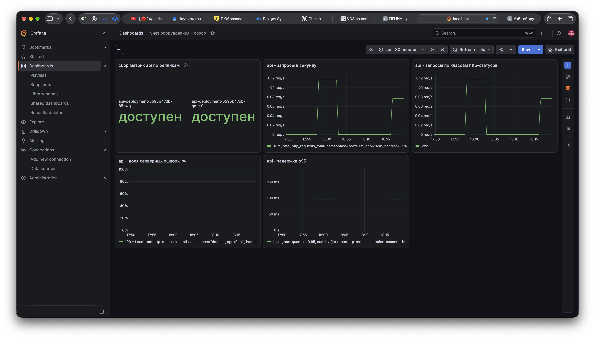
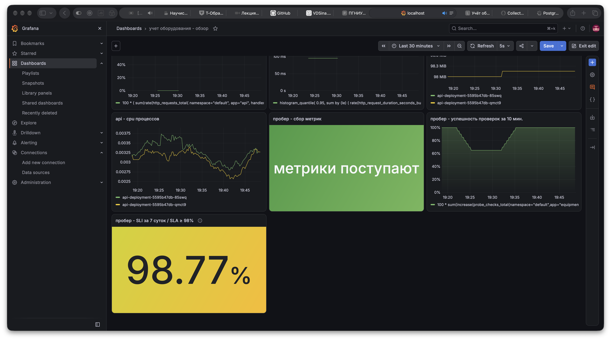
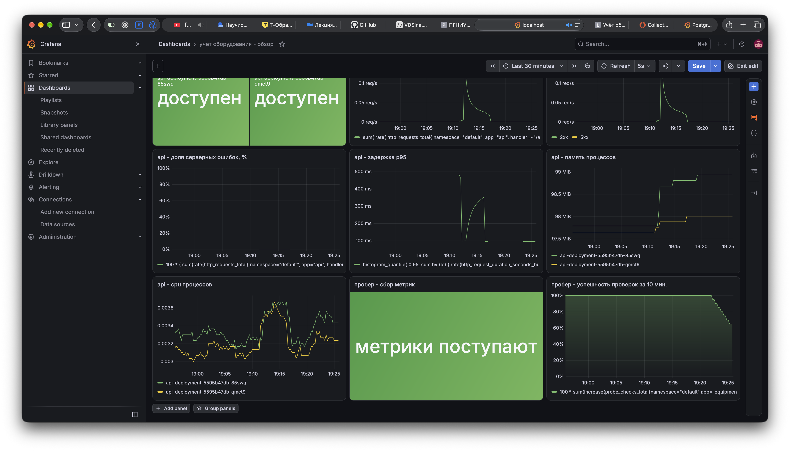
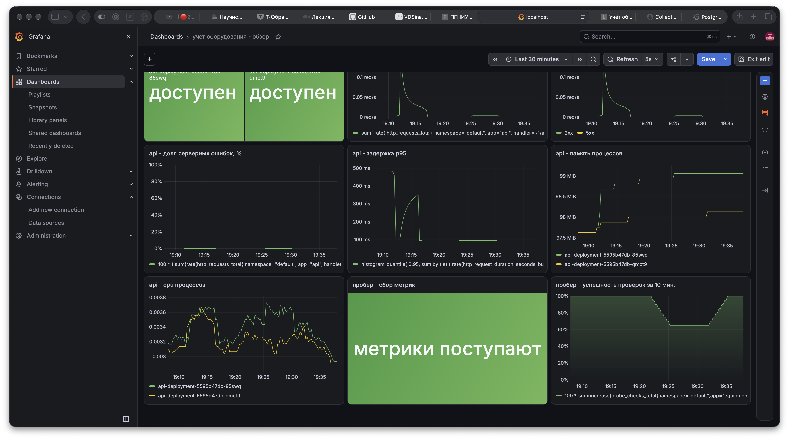
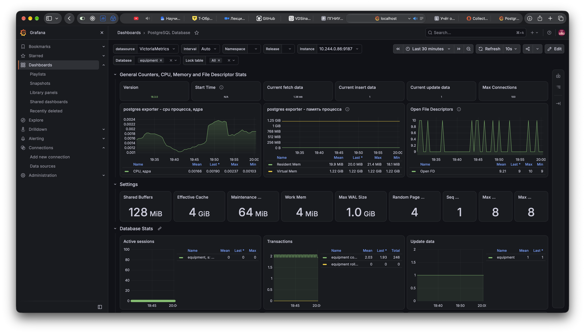
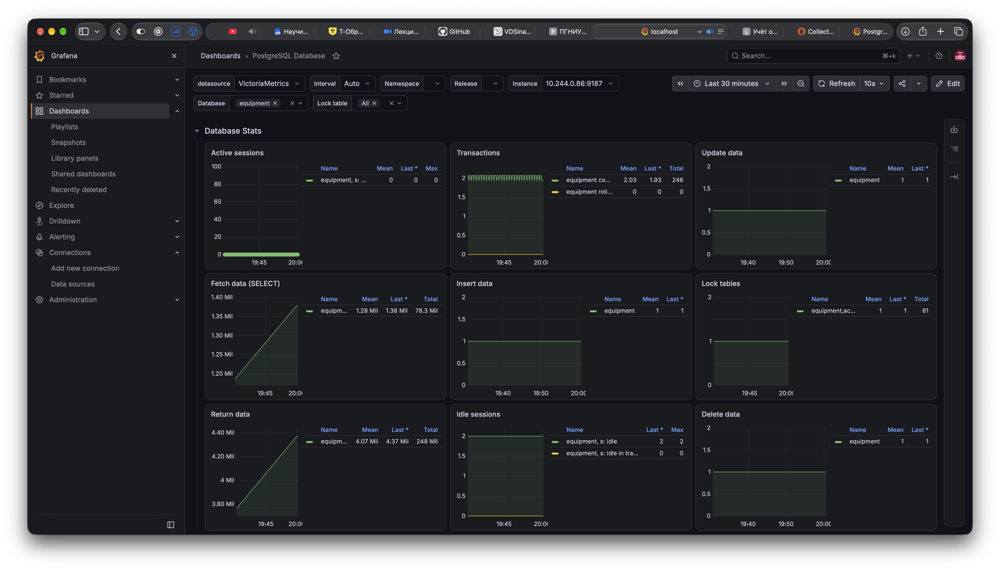

# ДЗ 7 Grafana

Собрал в Grafana дашборд приложения учёта оборудования и импортировал дашборд PostgreSQL. Использовал метрики API, пробера и postgres_exporter из предыдущих дз

## Запуск Grafana и источник данных

Сначала запустил остановленный профиль minikube `sre` и проверил приложение, VictoriaMetrics и подключённое хранилище. Затем установил Grafana через Helm в namespace `monitoring`: chart `grafana-community/grafana` версии `14.4.1`, Grafana `13.3.1`.

В grafana-values.yml включил PVC размером 1 GiB для сохранения настроек и дашбордов. Для доступа из браузера использовал проброс порта Service Grafana на `localhost:3000`.

grafana-values.yml:

```yaml
persistence:
  enabled: true
  size: 1Gi
```

В Grafana добавил источник типа Prometheus с названием `VictoriaMetrics` и адресом:

```text
http://vm-single-victoria-metrics-single-server.monitoring.svc:8428
```

Grafana обращается к VictoriaMetrics внутри Kubernetes. История метрик хранится в VictoriaMetrics, а Grafana выполняет запросы и отображает результаты. Через Explore проверил `up`: сборщик получал метрики обеих реплик API, пробера и exporter базы.

## Дашборд приложения

Создал дашборд с десятью панелями. Для HTTP-метрик выбрал маршруты `/api/v1/.*`, чтобы проверки здоровья не смешивались с запросами API.

| Панель                           | Метрики и расчёт                                                          | Зачем нужна                                                   |
| -------------------------------- | ------------------------------------------------------------------------- | ------------------------------------------------------------- |
| Сбор метрик API по репликам      | `up{app="api"}`                                                           | Показывает успешность опроса каждой реплики отдельно          |
| Запросы в секунду                | Сумма `rate(http_requests_total[5m])`                                     | Показывает нагрузку на API                                    |
| Запросы по классам HTTP-статусов | Тот же расчёт с группировкой по `status`                                  | Разделяет успешные ответы, клиентские и серверные ошибки      |
| Доля серверных ошибок            | RPS ответов `5xx` / общий RPS × 100%                                      | Показывает долю технических ошибок в трафике                  |
| Задержка p95                     | `histogram_quantile` по `http_request_duration_seconds_bucket` за 5 минут | Оценивает время, в которое укладываются примерно 95% запросов |
| Память процессов API             | `process_resident_memory_bytes`                                           | Показывает резидентную память каждой реплики                  |
| CPU процессов API                | `rate(process_cpu_seconds_total[5m])`                                     | Показывает использование CPU каждой репликой в ядрах          |
| Сбор метрик пробера              | `up{app="equipment-prober"}`                                              | Помогает отличить сбой приложения от потери наблюдений        |
| Успешность проверок за 10 минут  | Прирост успешных проверок / прирост всех проверок × 100%                  | Показывает реакцию пробера на сбой и восстановление           |
| SLI за 7 суток / SLA ≥ 98%       | Такой же расчёт за 7 суток                                                | Сравнивает доступность по проберу с учебными целями SLA и SLO |

RPS, ошибки и задержка покрывают RED. Это также трафик, ошибки и задержка из Golden Signals. Панели CPU и памяти помогают искать причины ухудшения работы. Полный USE я решил не реализовывать

Скорость счётчиков сначала рассчитывается для каждой серии, затем суммируется по репликам. Для доли ошибок складываю ошибки и запросы всех реплик, а не усредняю их проценты. Ответ `409` при попытке выдать занятое оборудование относится к ожидаемым отказам бизнес-логики и не входит в `5xx`.

Если серия `5xx` отсутствует, в числителе использую `or vector(0)`. При отсутствии трафика доля ошибок остаётся неопределённой. Аналогично, разрыв графика p95 без запросов не заменяю нулём. Сам p95 рассчитывается приближённо по границам buckets.



## Пробер и учебное SLA

Пробер раз в 30 секунд проверяет внутренний путь Nginx → API → PostgreSQL через `/health/ready`. Успешной считается проверка с HTTP 200 и ожидаемым содержимым JSON. Для расчёта использую счётчик `probe_checks_total` с результатами `success` и `failure`:

```promql
100 *
sum(increase(probe_checks_total{
  namespace="default", app="equipment-prober", result="success"
}[7d]))
/
sum(increase(probe_checks_total{
  namespace="default", app="equipment-prober"
}[7d]))
```

Добавил SLA доступности по проберу: не менее 98% успешных проверок за скользящие семь суток. SLO оставил на уровне 99%. Предметный SLA из предыдущего задания остаётся отдельным соглашением.

Для недельной Stat-панели выбрал Instant-запрос и абсолютные пороги: ниже 98% красный цвет, от 98% до 99% жёлтый, от 99% зелёный. На скриншоте значение 98,77% находится в жёлтой зоне. Это расчёт по доступным наблюдениям; полнота истории за неделю не подтверждена, поэтому по нему нельзя заявить о выполнении недельного SLA.



Для эксперимента уменьшил число реплик `db-deployment` до нуля и попробовал открыть данные приложения. Успешность проверок за 10 минут снизилась примерно до 65%. При этом метрики пробера продолжали поступать. Реплики API также отдавали `/metrics`: успешный сбор метрик сам по себе не подтверждает работу операций с БД.



После этого вернул одну реплику PostgreSQL и проверил загрузку данных в приложении. Показатель пробера вернулся к 100%, когда неуспешные проверки вышли из десятиминутного окна.



## Дашборд PostgreSQL

Импортировал [PostgreSQL Database, ID 9628](https://grafana.com/grafana/dashboards/9628-postgresql-database/) и подключил тот же источник `VictoriaMetrics`. Выбрал instance exporter на порту `9187` и базу `equipment`.

В готовом дашборде исправил несколько запросов. Из панелей активных сессий, вставленных, обновлённых и удалённых строк убрал `!= 0`, из-за которого нулевые значения превращались в `No data`. Для памяти убрал `rate`: нужен текущий объём, а не скорость его изменения. Для CPU оставил `rate(process_cpu_seconds_total[5m])` без умножения на 1000 и выставил числовые единицы. Эти панели показывают ресурсы процесса exporter, поэтому уточнил их названия. В панелях Insert, Update и Delete убрал `Total`, который складывал отсчёты накопленного счётчика.

Через приложение создал тестового сотрудника, изменил его имя и удалил запись. Счётчики `pg_stat_database_tup_inserted`, `pg_stat_database_tup_updated` и `pg_stat_database_tup_deleted` выросли. Также проверил отображение версии PostgreSQL, настроек БД, транзакций и сессий.





## Экспорт

Сохранил оба дашборда в JSON в формате Grafana V2 Resource:

- [Дашборд приложения](equipment-dashboard.json).
- [Дашборд PostgreSQL с исправлениями](postgres-dashboard.json).
