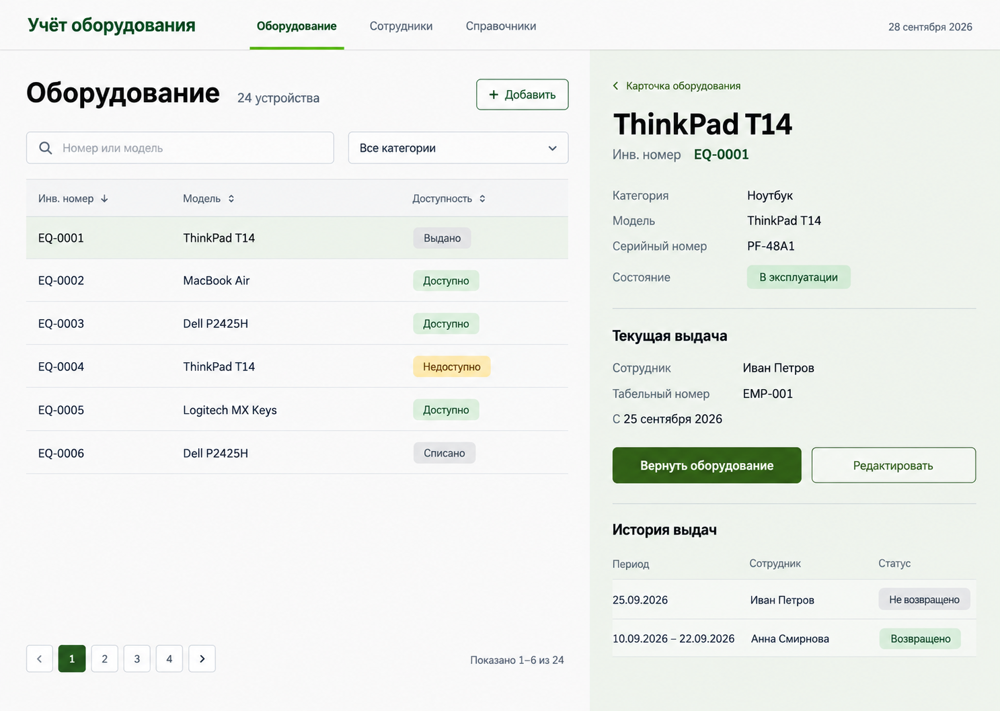

# Дизайн и UI-кит

Дата: 2026-09-28. Пользователь выбрал третий показанный вариант Product Design
и предложил базовую палитру. Визуальное направление и палитра зафиксированы;
UI-кит выбран для реализации: PrimeVue 4, styled mode, Aura.

Это визуальный ориентир, не скриншот реализованного приложения. Точные цвета
задаются токенами ниже, а не извлекаются из растрового изображения. Примеры в
макете показывают часть полей и фильтров; полные требования domain.md сохраняются.

## Цветовые токены

| Роль | Значение | Использование |
|---|---|---|
| surface.base | #f8f8f8 | Основной фон |
| brand.primary | #337418 | Основные кнопки, ссылки, активная навигация, фокус |
| brand.accent | #5dd62c | Небольшие декоративные акценты, подчёркивание активного раздела |
| text.primary | #202020 | Основной текст |
| text.heading | #0f0f0f | Заголовки |
| text.onPrimary | #f8f8f8 | Текст на основной кнопке |
| text.secondary | #606060 | Подписи и вторичный текст |
| surface.selected | #eef4eb | Выделенная строка и правая область карточки |
| border.subtle | #dedede | Декоративные разделители |
| border.control | #858585 | Границы полей ввода |
| primary.hover | #2b6214 | Наведение основной кнопки |
| primary.active | #245210 | Нажатие основной кнопки |
| danger.text | #b42318 | Ошибка или разрушительное действие |
| danger.surface | #fef3f2 | Фон сообщения об ошибке |
| warning.text | #854d0e | Временная недоступность |
| warning.surface | #fefce8 | Фон предупреждения |
| neutral.surface | #e9e9e9 | Нейтральные метки |

Пять предложенных цветов — основа бренда. Дополнительные нейтральные оттенки,
hover/active и семантические цвета нужны для состояний компонентов.
Светлая тема — единственная в MVP; не переключать её вслед за темой ОС.

Контраст рассчитан по относительной яркости sRGB:

| Текст / фон | Контраст |
|---|---|
| #f8f8f8 / #337418 | 5.41:1 |
| #337418 / #f8f8f8 | 5.41:1 |
| #202020 / #f8f8f8 | 15.34:1 |
| #0f0f0f / #f8f8f8 | 18.05:1 |
| #202020 / #5dd62c | 8.63:1 |
| #5dd62c / #f8f8f8 | 1.78:1 — не использовать для текста |

Для обычного текста целимся в WCAG AA 4.5:1. Нельзя делать ярко-зелёный текст
на светлом фоне или светлый текст на ярко-зелёной кнопке. Фокус — контрастное
кольцо #337418 с отступом, не только яркий акцент. Расчёт пар не заменяет
проверку доступности всего приложения после реализации.

## UI-кит и границы собственной разработки

PrimeVue 4 + тема Aura из @primeuix/themes; настройка через definePreset и
семантические токены. PrimeIcons для иконок. Точные версии фиксируются при установке.
Использовать готовые компоненты с прямыми импортами; не импортировать все компоненты
пакетом. Tailwind и второй UI-кит для MVP не нужны.

| Задача | Компоненты |
|---|---|
| Таблица и пагинация | DataTable, Column, Paginator |
| Формы | InputText, Textarea, Select, Checkbox |
| Действия | Button |
| Формы создания/редактирования | Dialog |
| Подтверждение удаления/списания | ConfirmDialog |
| Метки и сообщения | Tag, Message, Toast |
| Загрузка | Skeleton, ProgressSpinner |

Для длинных списков сотрудников и моделей использовать готовые поля с серверным
поиском и пагинацией; не загружать весь справочник в браузер. Управление данными,
валидация API и обработка ошибок принадлежат приложению, а не UI-киту.
Ошибки формы показывать рядом с полями и в Message; Toast — только вспомогательное
подтверждение успешного действия. Подписи и локализация — русские.

Собственные компоненты — только предметные композиции: карточка оборудования,
форма выдачи, история, общий каркас страниц. Не писать свои кнопки, селекты,
диалоги, таблицы или управление фокусом вместо возможностей UI-кита.
Не создавать абстрактную систему обёрток вокруг каждого компонента PrimeVue.

## Компоновка и типографика

- Верхняя навигация: Оборудование, Сотрудники, Справочники.
- Список слева, карточка выбранного экземпляра справа; сохранять отдельный URL карточки.
- На ширине от 1200 px: две колонки примерно 60/40; меньшая ширина — карточка
  на отдельной странице с возвратом к списку, а не сжатие таблицы и формы.
- Системный sans-serif с поддержкой кириллицы; без внешнего шрифтового CDN.
- Основной текст 16 px, подписи 14 px, заголовок страницы 32 px, секции 20 px.
- Шаг отступов 4 px; обычные промежутки 8/16/24/32 px; радиус контролов 6 px.
- Высота основных полей/кнопок не менее 40 px. Контент страниц — без вложенных карточек.
- Клик по строке дополняется доступной с клавиатуры ссылкой на карточку.
- Поля состояния и доступности различаются, даже если в компактном списке показана
  одна производная метка. Указанные в domain.md сведения не удалять ради макета.

## Семантика и состояния

- Доступно: зелёный текст, светло-зелёный фон.
- Выдано / Не возвращено: нейтральная метка — открытая выдача сама по себе не ошибка.
- Недоступно: предупреждение; Списано: нейтральная метка с явным текстом.
- Красный используется для ошибок и разрушительных действий, не для обычной выдачи.
- Загрузка: Skeleton таблицы/карточки; сохранение: loading-кнопка без повторного запроса.
- Пустой список: текст и создание; пустой результат фильтра: предложение сбросить фильтр.
- Ошибка: постоянный Message и допустимое повторение чтения; введённые значения сохраняются.
- Конфликт выдачи: сообщение о причине и обновление карточки, без автоматического POST.
- Фокус, hover, disabled и selected различаются; статус всегда имеет текстовую подпись.

## Источники и проверка

Документация PrimeVue проверена через Context7 и официальный сайт:
[темы](https://primevue.org/theming/styled/), [таблицы](https://primevue.org/datatable/).
Контраст: [WCAG 2.2, 1.4.3](https://www.w3.org/WAI/WCAG22/Understanding/contrast-minimum.html).
Визуальное соответствие и клавиатурные сценарии проверяются после реализации,
не считаются выполненными по одному макету.
