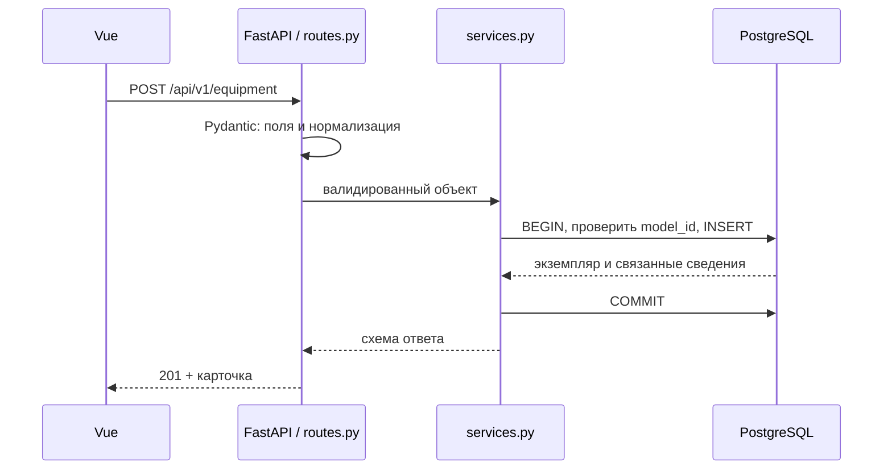

# Разбор основной реализации

## Этап 3: PostgreSQL и демонстрационные данные

Первая ревизия Alembic создаёт пять таблиц из database.md. FK RESTRICT защищают
связи, CHECK — формат и допустимые значения, UNIQUE — номера и нормализованные
названия. Частичный UNIQUE по equipment_id работает только для returned_at IS NULL.
Он защищает от двойной выдачи даже при обходе HTTP API.

ORM-модели не заменяют миграции: новая БД создаётся командой Alembic, а не create_all.
`alembic check` проверяет отсутствие расхождений ORM со схемой. PostgreSQL 18 отражает
TRIM как `TRIM(BOTH FROM ...)`; выражения индексов в models.py записаны так же,
чтобы автогенерация не предлагала бессмысленное пересоздание индексов.

Seed выполняется одной транзакцией. Advisory lock сериализует два одновременных
запуска. Найденные записи сравниваются с ожидаемыми полями; изменённая запись вызывает
SeedConflict, а не UPDATE. Поэтому после редактирования демо команда может отказать —
это предусмотренная защита изменений, а не повод очищать volume.

Проверка: `make migrate`, дважды `make seed`, `make test`.
После `make stop` → `make dev` записи остаются в PostgreSQL volume.

## Этап 4: HTTP и CRUD

Путь запроса:

Pydantic запрещает неизвестные поля, обрезает крайние пробелы, переводит номера
в верхний регистр и пустые необязательные строки в null. PATCH различает отсутствие
поля и явный null: обязательное поле нельзя обнулить, примечание можно очистить.

CRUD-обработчики одинаковы по HTTP-форме, поэтому регистрируются одной небольшой
функцией. Предметные правила остаются явными в services.py, без универсального ORM-framework.
Списки загружают связанные данные JOIN-ами, не делают отдельный запрос на каждую строку.
Ошибки содержат стабильный код, текст и request_id. Пароли, SQL-параметры и тела запросов
не попадают в ответ или журнал HTTP.

Проверка: `/docs` показывает контракты; `make types` обновляет TypeScript-типы;
`make test` проверяет нормализацию, CRUD, фильтры, ограничения и откат.

## Этап 5: выдача и возврат

Выдача блокирует строки в порядке сотрудник → оборудование; возврат дополнительно
блокирует выдачу. После получения блокировки ORM перечитывает состояние
(`populate_existing`), чтобы не использовать объект из старого чтения сессии.
Проверка активности и доступности выполняется под блокировкой внутри той же транзакции.

Если первый запрос выдал устройство, второй ждёт блокировку и затем увидит открытую
выдачу. Если первым успело списание, выдача после ожидания увидит retired и откажет.
Аналогично работает деактивация сотрудника. COMMIT происходит прежде успешного ответа.

Возврат адресован ID конкретной выдачи. Повтор PUT возвращает первоначальное время
и примечание; он не ищет «текущую выдачу устройства», поэтому не закрывает новую выдачу.
Времена задаёт сервер после блокировок; сравнение с предыдущим временем не допускает
отрицательной длительности при коррекции часов.

Конкурентные тесты используют разные соединения, Event и наблюдение pg_stat_activity:
первый запрос удерживает блокировку, второй подтверждённо ожидает Lock, затем первый
продолжается. Проверка не зависит от удачного совпадения sleep.

## Этап 6: интерфейс

ResourceView управляет списком и хранит поиск/фильтры/страницу/сортировку в URL.
ResourceForm собирает разрешённые поля; RelationPicker — предметная композиция
Dialog, DataTable и Paginator для серверного поиска по справочникам.
EquipmentDetail и EmployeeDetail показывают карточки; AssignmentHistory — историю.

Все HTTP-запросы проходят через fetch в api.ts. Нет автоматических повторов мутаций.
Форма сохраняет ввод при ошибке; кнопка блокируется на время запроса. Для выдачи при
409, 5xx или сетевом сбое карточка перечитывается, повторное нажатие в этом окне
блокируется: сначала нужно проверить актуальные данные. Это важно, потому что обрыв
ответа не доказывает откат COMMIT на сервере.

Визуальная основа — сохранённый вариант 3 и design-system.md. При ширине меньше
1200 px карточка занимает отдельную страницу. Её адрес можно открыть напрямую.

## Сценарий самостоятельной проверки

1. `make dev` и при первом запуске `make seed`; открыть http://localhost:5173.
2. В «Справочниках» создать категорию и модель с уникальным учебным названием.
3. В «Сотрудниках» создать сотрудника. В «Оборудовании» создать экземпляр этой модели.
4. Выдать его сотруднику. Проверить получателя и историю в карточке.
5. Попытаться деактивировать сотрудника: приложение объяснит необходимость возврата.
6. Вернуть устройство с примечанием, затем выдать снова. В истории две записи.
7. Попытаться удалить использованное устройство: отказ сохранит историю.
8. Создать и удалить отдельную несвязанную категорию: физическое удаление разрешено.
9. Изменить поиск/фильтр, обновить страницу: условия сохраняются в URL.
10. Запустить `make test`, `make lint`, `make test-e2e` (подготовка браузера в README).

Следующий этап — отдельные runtime-образы, Nginx, GitHub Actions, две реплики,
проверка завершения SIGTERM и измерение ресурсов. Эти проверки не подменяются
успешным запуском разработки.
