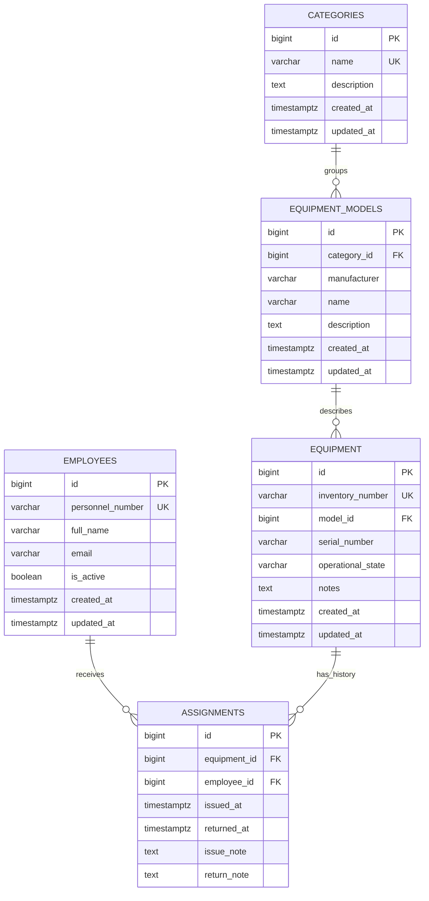
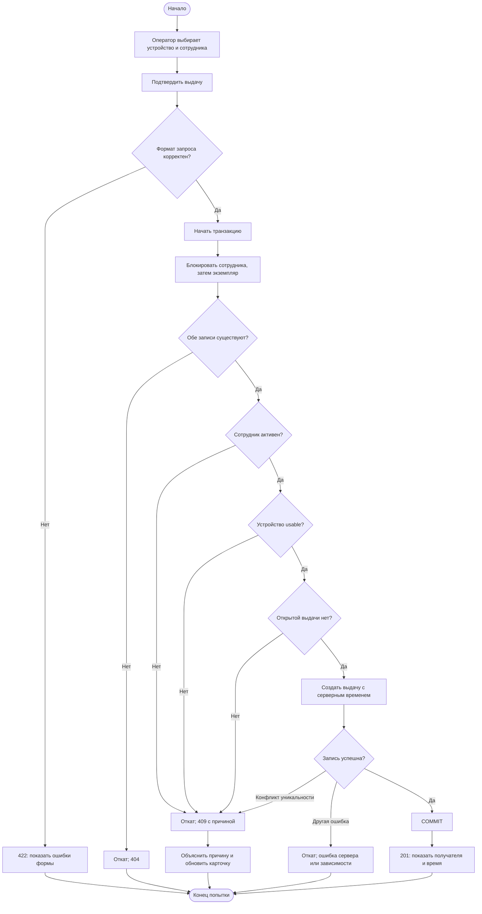
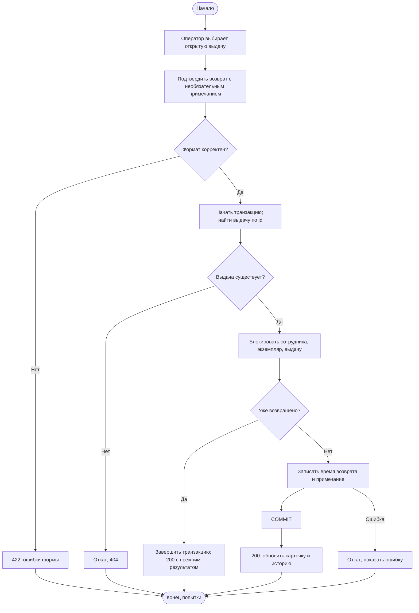
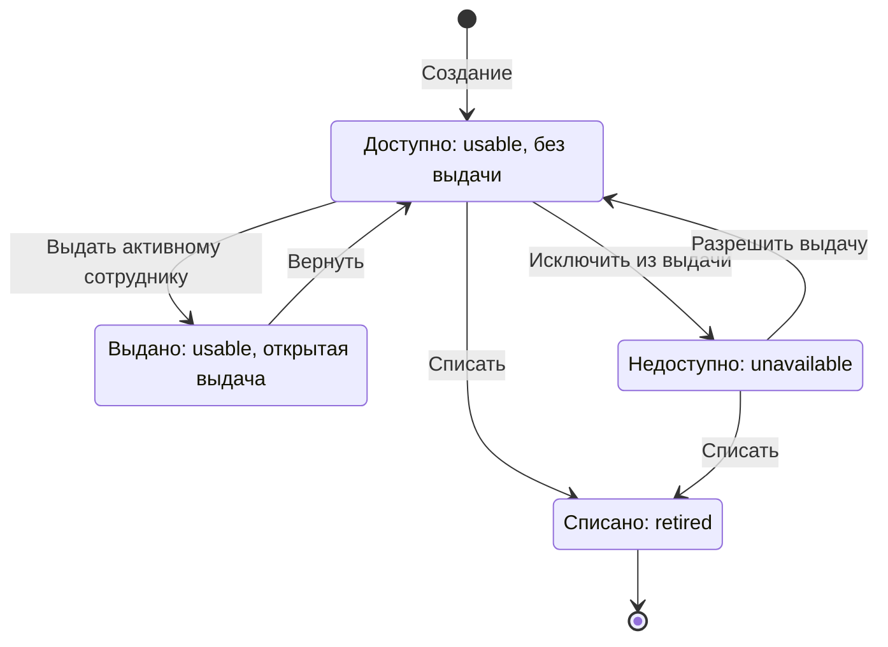
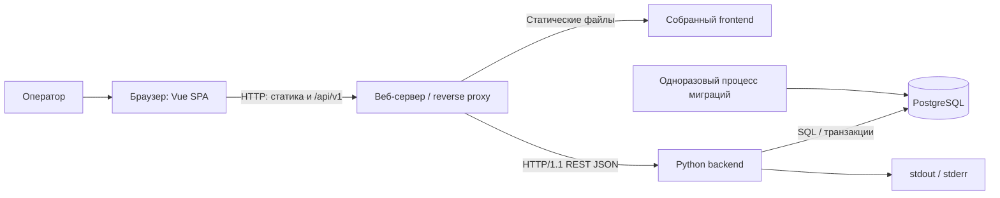

# Диаграммы v1

Mermaid-блоки — редактируемые исходники диаграмм, отображаемые в совместимом
Markdown-просмотрщике. Полный словарь атрибутов — [database.md](database.md).
Схемы активностей ниже используют flowchart-нотацию Mermaid, не строгую UML-нотацию.

## ER: сущности и связи

UK имени категории относится к нормализованному значению. Составная уникальность
производителя/имени модели и частичная уникальность открытой выдачи описаны в database.md;
обычная кардинальность ER не выражает правило «не больше одной открытой выдачи».

## Активность: выдача оборудования

Для краткости технические ошибки соединения/блокировки на предыдущих шагах не
прорисованы отдельными стрелками: они также прерывают транзакцию и не означают успех.

## Активность: возврат оборудования

Возврат адресуется по ID выдачи, не по ID устройства: повтор старого запроса не
должен случайно закрыть следующую выдачу этого же устройства.

## Состояния экземпляра

Это совокупное состояние экземпляра и его открытой выдачи. `Assigned` не отдельное
значение operational_state. Удаление карточки не бизнес-переход и показано правилами CRUD.

## Границы компонентов

Диаграмма показывает целевое окружение, а не существующее развёртывание. Несколько
backend-реплик могут использовать одну БД; балансировщик и наблюдаемость развиваются
в последующих заданиях. Браузер напрямую к PostgreSQL не подключается.
