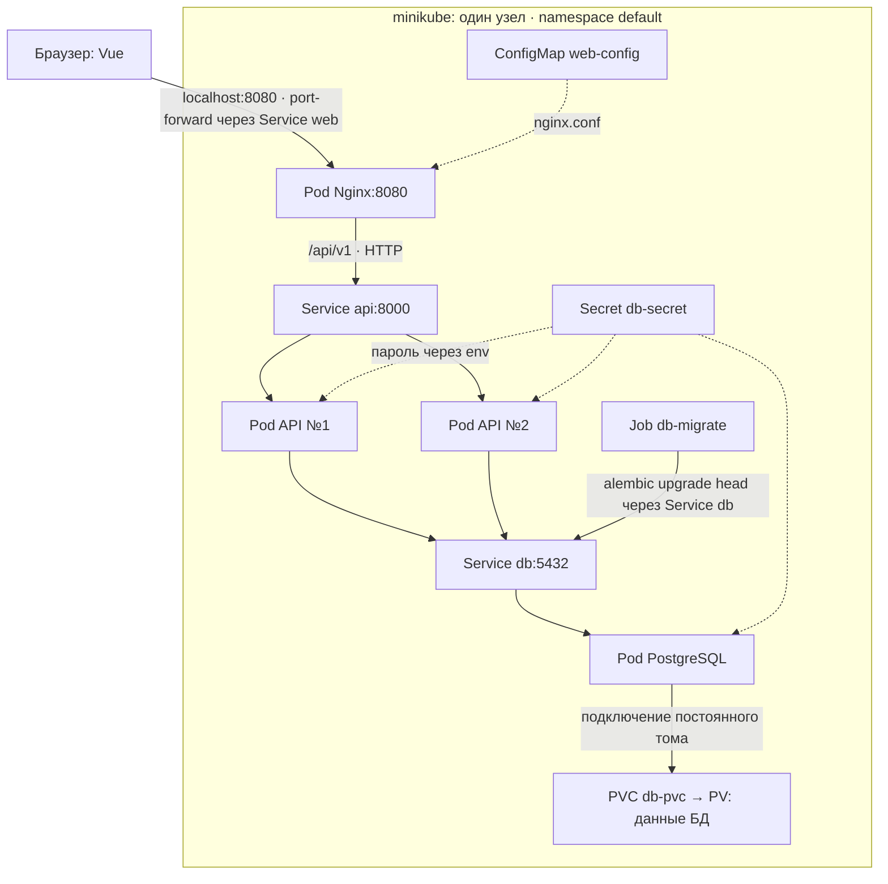
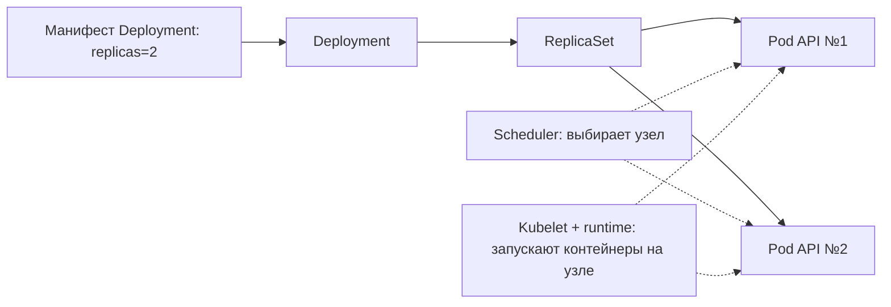
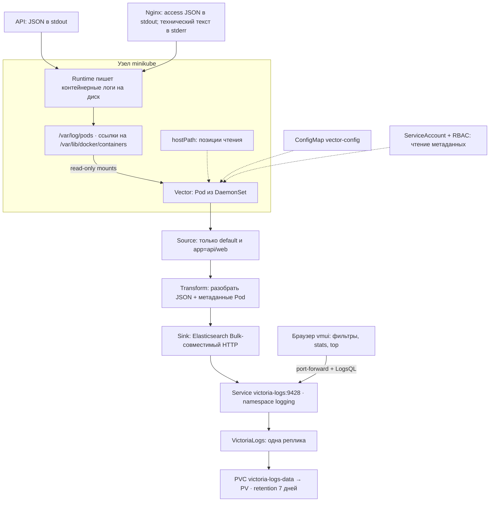

# Kubernetes и логирование: схемы и манифесты с комментариями

Учебные копии текущего `k8s/` для подготовки к защите. Исходные файлы и кластер не изменялись. Комментарии на русском объясняют назначение ресурсов и полей. YAML-значения проверены на совпадение с оригиналами, включая строковое содержимое ConfigMap.

**Исключение:** `db-secret.yml` содержит безопасную заглушку из `db-secret.yml.example`, а не реальный пароль. Эти копии предназначены для чтения: не применяйте каталог целиком к рабочему кластеру, иначе заглушка может заменить действующий Secret. `monitoring/victoria-metrics-values.yml` — параметры Helm, не ресурс для `kubectl apply`.

## ДЗ 2: путь пользовательского запроса



Сплошные стрелки показывают обращения/подключение хранилища, пунктир — конфигурацию. `port-forward svc/web` выбирает конкретный Pod через Service; обычный сетевой путь всех frontend-реплик этим не проверяется.

Две API-реплики — одинаковый код и общая база. Service направляет соединение к одной из реплик, а не дублирует запрос. PVC позволяет заменить Pod БД, сохранив данные на томе. Две реплики на одном узле и локальный том не защищают от потери узла.

## ДЗ 2: кто создаёт и поддерживает Pod



Это управление жизненным циклом, а не путь HTTP-запроса. ReplicaSet восстанавливает заданное число Pod. Service ищет Pod по labels/selector, а не создаёт их.

## ДЗ 3: путь логов



Elasticsearch здесь не установлен: VictoriaLogs самостоятельно принимает совместимый протокол. Vector читает файлы на узле; приложение не отправляет логи напрямую в БД логов. В single-node minikube один агент DaemonSet. Postgres не входит в фильтр источника.

## Порядок чтения файлов

### Вторая домашка

1. `api-deployment.yml` → `api-service.yml`: две реплики, labels/selector, env.
2. `web-deployment.yml` → `web-service.yml` → `web-configmap.yml`: статика, reverse proxy, конфигурация.
3. `db-deployment.yml` → `db-service.yml` → `db-pvc.yml`: подключение к БД и сохранение данных.
4. `db-secret.yml.example`: откуда компоненты получают пароль.
5. `migrate-job.yml`: одноразовое изменение схемы до запуска новой версии API.

### Третья домашка

1. `logging/namespace.yml`: namespace компонентов логирования.
2. `logging/deployment.yml`, `logging/service.yml`, `logging/pvc.yml`: VictoriaLogs, сеть, данные.
3. `logging/vector-daemonset.yml`: агент на узле, mounts и позиции чтения.
4. `logging/vector-rbac.yml`: доступ к метаданным Kubernetes.
5. `logging/vector-configmap.yml`: source → transform → sink; пояснения перед встроенной строкой конфига.
6. `web-configmap.yml`: JSON access-логи Nginx и request_id.

JSON formatter API находится в `backend/app/logging_config.py`, HTTP-контекст — в `backend/app/main.py`. Копии Python-файлов сюда не включены, поскольку это каталог манифестов.

### Четыре запроса из отчёта

```logsql
_time:15m service.name:="equipment-api"
```

Сырые записи API за последние 15 минут.

```logsql
_time:15m service.name:="equipment-web" status:="404"
```

Фильтр по конкретному полю: HTTP 404 у Nginx.

```logsql
_time:15m log_format:="json"
| stats by (service.name, level) count() as logs
```

Число записей для каждой пары сервис/уровень. Один HTTP-запрос может дать две записи, в API и Nginx.

```logsql
_time:15m service.name:="equipment-api" _msg:="HTTP request completed"
| top 5 by (route)
```

Пять самых частых маршрутов среди событий завершения запросов API. Это частота, не длительность.

## Что помнить на защите

- В текущем API Deployment нет probes, хотя HTTP health-endpoints реализованы.
- Теги API и Job миграций различаются: 0.1.4 и 0.1.0. Копии сохраняют это различие.
- Job рядом с Deployment не создаёт автоматическое ожидание миграций.
- PVC — не бэкап; ReadWriteOnce означает запись с одного узла, не строго один Pod.
- Nginx технические логи могут быть текстовыми; Vector сохраняет их отдельно по log_format.
- API завершения запросов логирует INFO независимо от статуса; Nginx различает 4xx/5xx.
- Checkpoints Vector не равны долговечной очереди доставки; отсутствие потерь не доказано.
- `monitoring/` и postgres-exporter уже присутствуют в исходниках и сохранены как дополнение по метрикам.

Схемы описывают конфигурацию файлов, а не измеренное текущее состояние кластера. Развёртывание и повторные проверки runtime в этой задаче не выполнялись.
