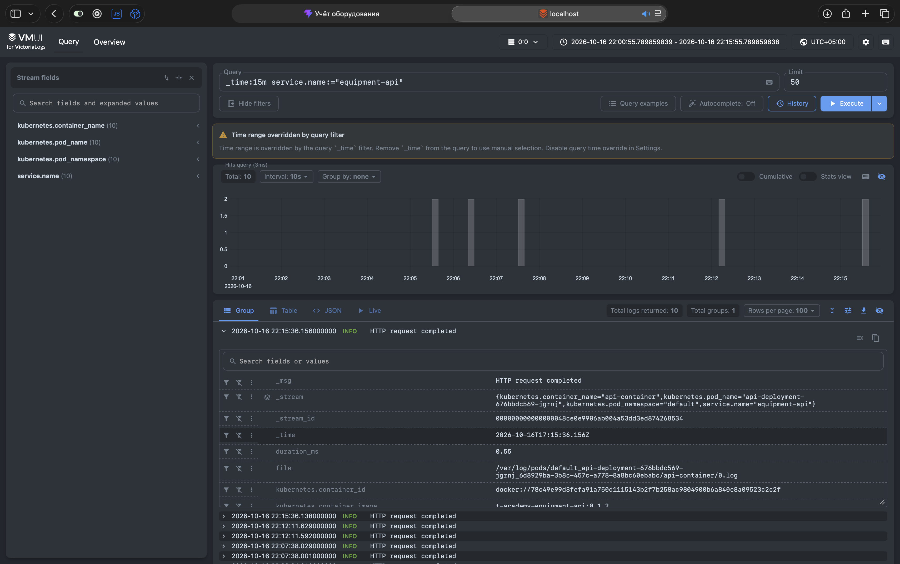
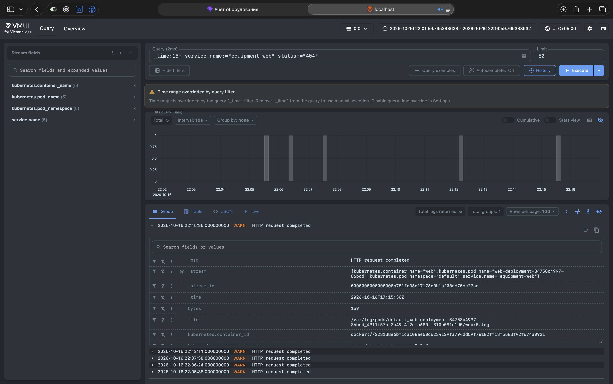
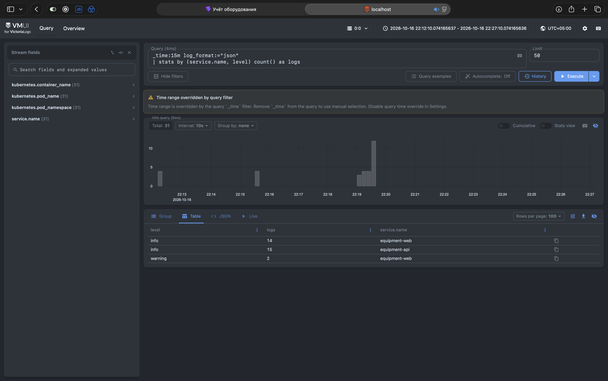
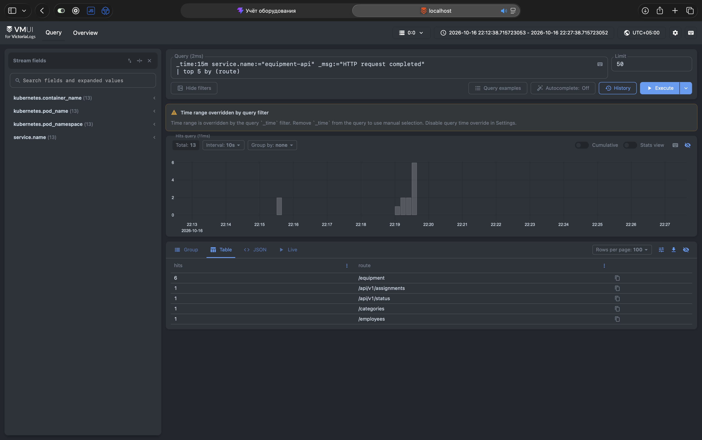

# Сбор логов приложения в VictoriaLogs

В существующем minikube-кластере с приложением учёта оборудования я развернул VictoriaLogs single-node и настроил доставку логов API и Nginx через Vector. В vmui проверил поиск записей и выполнил четыре LogsQL-запроса.

## Окружение и файлы

Приложение состоит из API на FastAPI, интерфейса на Vue с Nginx и PostgreSQL. Оно работает в namespace `default` однодового minikube-кластера с профилем `sre`. Драйвер и container runtime используют Docker; при проверке узел показал runtime `docker://29.7.2`.

Компоненты логирования находятся в namespace `logging`:

| Компонент              | Настройка                                                                 |
| ---------------------- | ------------------------------------------------------------------------- |
| VictoriaLogs           | `victoriametrics/victoria-logs:v1.53.0`, Deployment с одной репликой      |
| Vector                 | `timberio/vector:0.59.0-distroless-libc`, DaemonSet                       |
| Хранилище VictoriaLogs | PVC `victoria-logs-data`, 1 GiB, `ReadWriteOnce`, StorageClass `standard` |
| Срок хранения логов    | 7 дней                                                                    |
| Доступ к VictoriaLogs  | ClusterIP Service `victoria-logs`, порт 9428                              |

Манифесты и конфигурация доставки:

| Файл                                                     | Назначение                                             |
| -------------------------------------------------------- | ------------------------------------------------------ |
| [namespace.yml](k8s/logging/namespace.yml)               | Namespace `logging`                                    |
| [pvc.yml](k8s/logging/pvc.yml)                           | Хранилище логов                                        |
| [deployment.yml](k8s/logging/deployment.yml)             | Запуск VictoriaLogs и подключение PVC                  |
| [service.yml](k8s/logging/service.yml)                   | Сетевой адрес VictoriaLogs                             |
| [vector-rbac.yml](k8s/logging/vector-rbac.yml)           | ServiceAccount и права на чтение метаданных Kubernetes |
| [vector-configmap.yml](k8s/logging/vector-configmap.yml) | Источник, разбор записей и отправка в VictoriaLogs     |
| [vector-daemonset.yml](k8s/logging/vector-daemonset.yml) | Запуск Vector и подключение каталогов узла             |

## Формат логов приложения

Для API я добавил [JSON-форматтер](backend/app/logging_config.py) и подключил его в [run.py](backend/app/run.py) через параметр `log_config` Uvicorn. Сообщения приложения и сервера выводятся в stdout, одна запись занимает одну строку JSON. Middleware передаёт поля HTTP-запроса через `extra`, а форматтер сериализует запись целиком. Текстового префикса `INFO:` перед JSON больше нет.

Общие поля записи:

| Поле           | Содержимое                          |
| -------------- | ----------------------------------- |
| `timestamp`    | Время события с часовым поясом      |
| `level`        | Уровень записи                      |
| `message`      | Описание события                    |
| `service.name` | `equipment-api` или `equipment-web` |

HTTP-записи API также содержат `request_id`, `method`, `route`, `status` и `duration_ms`. Длительность измеряется в миллисекундах. В текущей реализации middleware пишет завершённые запросы с уровнем `info`, в том числе ответы `4xx`. Сообщения ошибок приложения используют уровень соответствующего вызова логгера.

В [ConfigMap Nginx](k8s/web-configmap.yml) access-логи настроены через `log_format` с `escape=json` и направлены в `/dev/stdout`. Помимо общих полей они содержат `request_id`, `method`, `path`, `status`, `request_time` и `bytes`. Поле `request_time` измеряется в секундах. Директива `map` задаёт уровень по HTTP-статусу: `4xx` получает `warning`, `5xx` получает `error`, остальные ответы получают `info`.

Nginx передаёт `request_id` в API через заголовок `X-Request-ID`. По нему можно сопоставить записи обоих сервисов об одном запросе.

Стартовые скрипты образа Nginx и его стандартный `error_log` продолжают писать текст. Vector сохраняет такие строки с `log_format=text` и `level=unknown`. JSON-записи приложения получают `log_format=json`. Это позволяет отличать исходно структурированные события от текстовых сообщений.

## Доставка через Vector

Я выбрал Vector в DaemonSet, потому что один агент на узле может собирать логи всех реплик API и Nginx. Приложение пишет события в stdout, а сбор и сетевую доставку выполняет агент. В однодовом minikube работает один Pod Vector.

Источник `kubernetes_logs` выбирает Pod из namespace `default` с меткой `app=api` или `app=web`. PostgreSQL и компоненты логирования в эту выборку не входят. Через Kubernetes API Vector получает имена Pod, контейнеров и namespace. Для этого ServiceAccount `vector` назначены права `list` и `watch` на `pods`, `namespaces` и `nodes`.

Преобразование `remap` разбирает JSON из поля `message` и объединяет поля приложения с метаданными Kubernetes. Затем sink типа `elasticsearch` отправляет события по адресу:

```text
http://victoria-logs.logging.svc.cluster.local:9428/insert/elasticsearch/
```

VictoriaLogs принимает этот протокол самостоятельно. Параметр `_msg_field=message` сопоставляет сообщение с системным полем `_msg`, а `_time_field=timestamp` задаёт время события `_time`. Поток определяется сочетанием `service.name`, `kubernetes.pod_namespace`, `kubernetes.pod_name` и `kubernetes.container_name`. Идентификатор запроса остаётся обычным полем.

### Особенность Docker runtime

При первом запуске Vector работал без ошибок, но записи не появлялись в VictoriaLogs. Проверка файлов узла показала, что `/var/log/pods/.../0.log` является символической ссылкой на файл в `/var/lib/docker/containers`.

В DaemonSet первоначально был подключён только `/var/log`. После добавления `/var/lib/docker/containers` по тому же пути внутри контейнера доставка заработала. Оба каталога подключены только для чтения. Позиции чтения Vector хранит отдельно: каталог узла `/var/lib/equipment-vector` подключён к `/var/lib/vector` контейнера.

## Развёртывание и проверки

Приложение из предыдущего задания уже работало в профиле `sre`. Образ API с JSON-логированием был собран командой:

```bash
minikube -p sre image build -t t-academy-equipment-api:0.1.2 ./backend
```

Тот же тег указан в `k8s/api-deployment.yml`. После обновления API и ConfigMap Nginx новые записи были проверены через `kubectl logs`.

Компоненты логирования развёрнуты следующими командами. Контекст `sre` выбран явно:

```bash
kubectl config use-context sre
kubectl apply -f k8s/logging/namespace.yml
kubectl apply -f k8s/logging/pvc.yml
kubectl apply -f k8s/logging/deployment.yml
kubectl apply -f k8s/logging/service.yml
kubectl apply -f k8s/logging/vector-rbac.yml
kubectl apply -f k8s/logging/vector-configmap.yml
kubectl apply -f k8s/logging/vector-daemonset.yml

kubectl -n logging rollout status deployment/victoria-logs --timeout=180s
kubectl -n logging rollout status daemonset/vector --timeout=180s
kubectl -n logging get pods,svc,pvc
```

PVC получил статус `Bound`. В логах VictoriaLogs появились сообщения об открытии `/victoria-logs-data` и запуске HTTP-сервера на порту 9428. Для доступа к vmui использован проброс порта:

```bash
kubectl -n logging port-forward svc/victoria-logs 9428:9428
```

Интерфейс доступен по адресу [http://localhost:9428/select/vmui/](http://localhost:9428/select/vmui/).

Сначала я отправил одну тестовую JSON-запись напрямую через `/insert/jsonline` и нашёл её в vmui. Затем заменил Pod VictoriaLogs через `rollout restart`, восстановил проброс порта и повторно нашёл прежнюю запись без новой отправки. Эта проверка подтвердила сохранение данных при замене Pod с тем же PVC.

После запуска Vector я создал события через интерфейс приложения и выполнил запросы:

```bash
curl -i http://localhost:8080/api/v1/status
curl -i http://localhost:8080/api/v1/does-not-exist
```

Ответы имели статусы `200` и `404`. Соответствующие записи API и Nginx появились в VictoriaLogs с разобранными HTTP-полями и метаданными Kubernetes.

## Запросы LogsQL

Все четыре запроса выполнены через vmui 16 октября. Фильтр `_time:15m` задаёт последние 15 минут на момент выполнения каждого запроса. Скриншоты сделаны в разное время, поэтому их выборки и счётчики различаются.

### 1. Сырые записи API за последние 15 минут

```logsql
_time:15m service.name:="equipment-api"
```

Запрос показывает отдельные события API. В результате на скриншоте 10 записей. У раскрытой записи видны сообщение `HTTP request completed`, время `_time`, длительность `duration_ms` и метаданные контейнера.



### 2. Фильтр по HTTP-статусу

```logsql
_time:15m service.name:="equipment-web" status:="404"
```

Запрос выбирает записи Nginx с точным значением поля `status`, равным `404`. На скриншоте найдено 5 записей с уровнем `warning`.



### 3. Количество записей по сервисам и уровням

```logsql
_time:15m log_format:="json"
| stats by (service.name, level) count() as logs
```

После отбора исходно JSON-записей `stats` группирует их по имени сервиса и уровню, а `count()` считает записи в каждой группе. Запрос показывает распределение логов между сервисами и уровнями. Счётчики относятся к записям: один HTTP-запрос может оставить событие и в Nginx, и в API.



### 4. Пять наиболее частых маршрутов API

```logsql
_time:15m service.name:="equipment-api" _msg:="HTTP request completed"
| top 5 by (route)
```

Фильтр по `_msg` оставляет записи завершённых HTTP-запросов. `top` выбирает пять наиболее частых значений `route`, поле `hits` показывает число записей для каждого маршрута.


